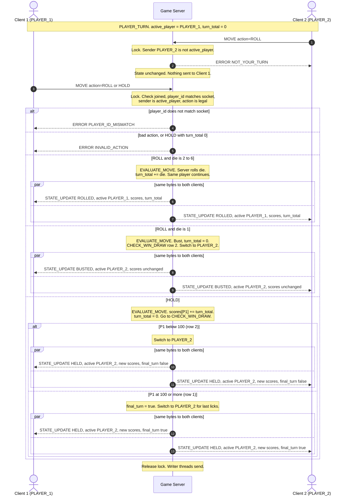
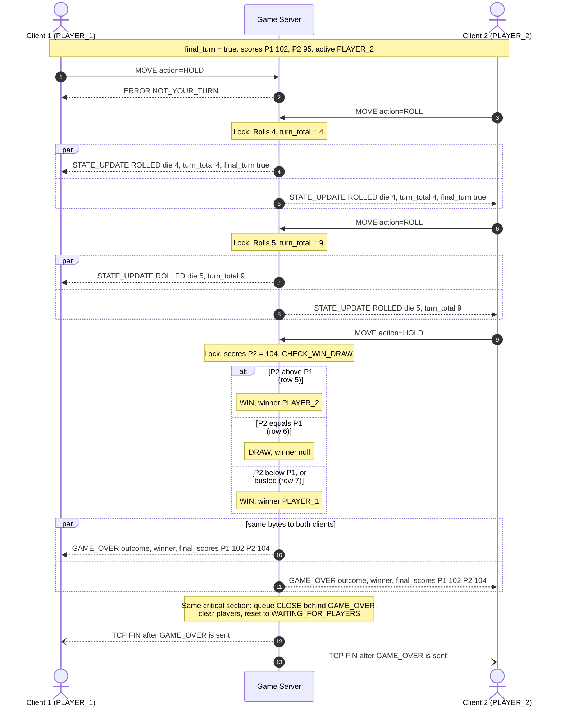
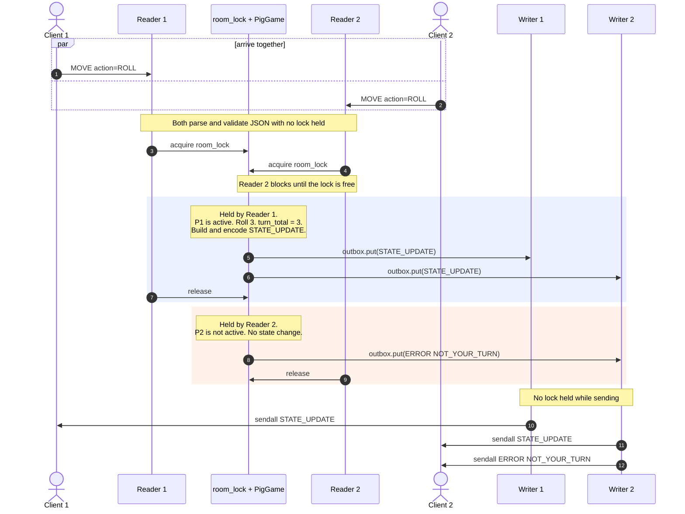

# Concurrency Design — CLI Pig

**Project:** CS 457 Multiplayer Network Game
**Student:** Wade McCaulley
**Sprint:** 2 — Game Behavior & Server Concurrency Architecture

This document covers how the server handles two clients at once without blocking, how shared game state is protected, and how every score and turn change reaches both players in the same order.

---

## 1. Concurrency Model: Multi-Threading

**Choice:** Option A — `threading.Thread`, with dedicated threads per client socket.

| | Threads (chosen) | `selectors` event loop |
|---|---|---|
| Receive code | Blocking `recv()` in a loop. Matches blueprint §2.5 line for line. | Non-blocking reads, partial-write tracking, register/unregister write interest. |
| Idle player | Thread sleeps inside `recv()`; costs no CPU. | Same. |
| Shared state | Needs a lock. | No lock needed (one thread). |
| Scale | Fine for 2 players. Would not scale to thousands. | Scales well. |

Pig has one room and two players, so scale doesn't matter. Threads keep the network code short and readable, and the one real cost — shared state — is handled by a single lock (Section 4).

---

## 2. Thread Inventory

| Thread | How many | Blocks on | Owns (no other thread touches) |
|---|---|---|---|
| **Main / acceptor** | 1 | `listen_sock.accept()` | The listening socket |
| **Reader** | 1 per connection | `conn.sock.recv(4096)` | That connection's `LineBuffer` and the socket's receive side |
| **Writer** | 1 per connection | `conn.outbox.get()` (`queue.Queue`) | The socket's send side |

At most 1 + 2 × 2 = 5 threads during a game, plus a short-lived pair for any rejected third client. All worker threads are daemon threads, so Ctrl+C on the server exits cleanly.

### Why a separate writer thread per client

The Sprint 1 FSM said handlers would "release the lock, then send." Working through it, that has an ordering bug:

1. Player 1's reader thread rolls a 5, builds a `STATE_UPDATE`, releases the lock.
2. Before it calls `sendall()`, Player 2's link drops. Player 2's reader takes the lock, builds `GAME_OVER FORFEIT`, and sends it first.
3. Player 1's screen shows the game ending, then a roll that happened before it ended.

Sending *while holding* the lock fixes the order but means one stalled client (full TCP send buffer on a degraded link) freezes the whole room.

The writer thread solves both. Messages are **put on the recipient's queue while the lock is held** — that fixes their order — and the writer thread does the `sendall()` **outside the lock** — so a slow client only stalls its own writer. `queue.Queue` is thread-safe and FIFO, and `put()` on an unbounded queue never blocks.

---

## 3. Connection Lifecycle

Each accepted socket gets a `Connection` object:

```python
@dataclass
class Connection:
    sock: socket.socket
    addr: tuple[str, int]
    outbox: queue.Queue          # bytes to send, or the CLOSE sentinel
    buffer: LineBuffer           # reader thread only
    role: str | None = None      # "PLAYER_1" / "PLAYER_2" once joined
    closed: bool = False         # set once, under room_lock
```

### 3.1 Listen (FSM `INIT`)

```python
listen_sock = socket.socket(socket.AF_INET, socket.SOCK_STREAM)
listen_sock.setsockopt(socket.SOL_SOCKET, socket.SO_REUSEADDR, 1)
listen_sock.bind(("0.0.0.0", args.port))
listen_sock.listen(5)
```

Any `OSError` here (port in use, port out of range, no permission) prints a clear message and exits with code 1. Success → `WAITING_FOR_PLAYERS`.

### 3.2 Accept

The main thread loops on `accept()`. For each new socket it:

1. Turns on TCP keepalive (blueprint §6.3: idle 30 s, interval 10 s, 3 probes).
2. Sets a **join timeout**: `sock.settimeout(15)`.
3. Builds the `Connection`, starts its writer thread, then its reader thread.
4. Goes straight back to `accept()`.

The accept loop never reads, writes, or touches room state, so a slow or hostile client can't block new connections.

### 3.3 Registration (`CONNECT`)

The first line from a socket must be `CONNECT`. The reader thread validates the envelope and alias (no lock needed — it's pure parsing), then takes `room_lock`:

| Room state | Result |
|---|---|
| `LOBBY_EMPTY` | `conn.role = "PLAYER_1"`. Enqueue `LOBBY_WAIT`. |
| `LOBBY_ONE` | `conn.role = "PLAYER_2"`. Enqueue `GAME_START` to each player (own copy), then `STATE_UPDATE TURN_START` to both. → `PLAYER_TURN` |
| Game running | Enqueue `ERROR LOBBY_FULL`, then `CLOSE`. No room state touched. |

Once a socket has a role, the reader calls `sock.settimeout(None)`. From then on, a dead peer is detected only by EOF, RST, or keepalive — never by an idle timer, so a player thinking about whether to hold isn't kicked.

The join timeout only applies before `CONNECT`. A socket that connects and says nothing for 15 s is closed with no state change. This keeps a stray connection (port scan, stuck client) from tying up threads.

### 3.4 Servicing (active game loop)

**Reader thread** — blueprint §2.5, plus the lock:

```python
while True:
    try:
        chunk = conn.sock.recv(RECV_CHUNK)
    except (ConnectionResetError, ConnectionAbortedError, TimeoutError, OSError):
        drop(conn, "network"); break
    if not chunk:                                  # EOF
        drop(conn, "eof"); break
    try:
        lines = conn.buffer.feed(chunk)
    except FrameTooLargeError:
        send_error_and_close(conn, "MESSAGE_TOO_LARGE"); break
    for line in lines:
        try:
            msg = parse_line(line)                 # no lock: stateless checks
            validate_payload(msg, sender_is_client=True)
        except ProtocolError as e:
            enqueue_error(conn, e.code, e.detail)
            continue
        handle(conn, msg)                          # takes room_lock
```

**Writer thread:**

```python
while True:
    item = conn.outbox.get()                       # blocks; no spin
    if item is CLOSE:
        break
    try:
        conn.sock.sendall(item)
    except (BrokenPipeError, ConnectionResetError, ConnectionAbortedError, OSError):
        drop(conn, "network")
        break
try:
    conn.sock.shutdown(socket.SHUT_RDWR)           # wakes the reader's recv()
except OSError:
    pass
conn.sock.close()
```

`shutdown()` matters: on Linux, `close()` from one thread does not wake another thread blocked in `recv()` on the same socket. `shutdown()` does — the reader gets `b""` or `OSError` and exits.

### 3.5 Teardown

Every exit path goes through one function, `drop(conn, how)`:

```python
def drop(conn, how):
    with room_lock:
        if conn.closed:                             # already handled
            return
        conn.closed = True
        if conn.role and room.players.get(conn.role) is conn:
            out = game.handle_disconnect(conn.role, how)
            route(out)                              # e.g. GAME_OVER FORFEIT to the other player
            del room.players[conn.role]
            if game.state is ServerState.CLEANUP:
                cleanup_room()
        conn.outbox.put(CLOSE)
```

| How it ends | Who notices | Path |
|---|---|---|
| `DISCONNECT` message | Reader | `drop(conn, "quit")` |
| TCP FIN (`recv()` → `b""`) | Reader | `drop(conn, "eof")` |
| RST, abort, keepalive timeout | Reader (or writer) | `drop(conn, "network")` |
| `sendall()` fails | Writer | `drop(conn, "network")` |
| 4096 bytes, no `\n` | Reader | enqueue `ERROR MESSAGE_TOO_LARGE`, then `drop(conn, "network")` |
| Game finished | Whichever thread processed the last move | `cleanup_room()` |

**Game over → `CLEANUP`**, all in the same locked section as the final move:

1. Enqueue `GAME_OVER` to both players.
2. Enqueue `CLOSE` to both. Because the queue is FIFO, each writer sends `GAME_OVER` before it closes.
3. Mark both connections `closed`, clear `room.players`, call `game.reset()` → `WAITING_FOR_PLAYERS`.

New clients can join immediately. The old reader threads wake up on the shutdown, call `drop()`, see `conn.closed`, and do nothing.

**Stale-thread guard:** `drop()` and `handle()` look players up by the `Connection` object, never by the role string. After a reset, `"PLAYER_1"` may be a different person; a late `drop()` from last game's thread must not kick them. The `room.players.get(conn.role) is conn` check makes that impossible.

---

## 4. Thread Safety & Lock Strategy

### 4.1 Shared resources

| Resource | Lives in | Written by | Protected by |
|---|---|---|---|
| FSM state (`ServerState`) | `PigGame.state` | Both reader threads, any writer via `drop()` | `room_lock` |
| Player table (`role → Connection`) | `room.players` | Readers (join, drop), writers (drop) | `room_lock` |
| Aliases | `PigGame.aliases` | Readers (join) | `room_lock` |
| Banked scores | `PigGame.scores` | Active reader (hold), reset | `room_lock` |
| Turn total | `PigGame.turn_total` | Active reader (roll, bust, hold) | `room_lock` |
| Active player | `PigGame.active_player` | Active reader (bust, hold) | `room_lock` |
| Last-licks flag | `PigGame.final_turn` | Active reader (hold), reset | `room_lock` |
| Die RNG | `PigGame.rng` | Active reader (roll) | `room_lock` |
| `Connection.closed` | each `Connection` | `drop()`, `cleanup_room()` | `room_lock` |
| Outbound queues | each `Connection.outbox` | Any thread `put()`s; one writer `get()`s | `queue.Queue` internal lock |

**Not shared** (one thread only, no lock needed): each `LineBuffer` (its reader), the receive side of each socket (its reader), the send side of each socket (its writer).

### 4.2 Lock rules

1. **One lock.** `room_lock = threading.Lock()`. With a single lock there's no lock ordering to get wrong, so no deadlock.
2. **Always `with room_lock:`** so an exception inside a handler still releases it.
3. **One handler = one critical section.** Read state, check turn, mutate, build every outbound message, `json.dumps` and encode it, enqueue it — then release. No other thread can see a half-applied move.
4. **`EVALUATE_MOVE` and `CHECK_WIN_DRAW` run in the same critical section.** A disconnect can't land between a bust and the turn switch; it waits for the lock and is processed from `PLAYER_TURN`.
5. **Messages are encoded inside the lock.** The bytes reflect the state at that moment. Encoding later, from a reference to the live `scores` dict, could pick up a later change.
6. **Never held during** `recv()`, `sendall()`, `accept()`, `sleep()`, or anything else that can block on the network. The lock is held for microseconds.
7. **Stateless checks happen before the lock.** UTF-8, JSON, envelope, `msg_type`, payload schema, alias pattern — none of these read room state.

### 4.3 The critical section

```python
def handle(conn, msg):
    with room_lock:                                  # acquire
        if conn.closed:
            return                                   # stale thread, room already reset
        if msg["msg_type"] == "CONNECT":
            out = join(conn, msg)                    # §3.3
        elif msg["msg_type"] == "DISCONNECT":
            out = []                                 # drop() below does the work
        elif conn.role is None:
            out = [error_to(conn, "GAME_NOT_STARTED")]
        elif msg["player_id"] != conn.role:
            out = [error_to(conn, "PLAYER_ID_MISMATCH")]
        else:
            out = game.handle_move(conn.role, msg["payload"]["action"])
        route(out)                                   # encode + outbox.put(), still locked
        if game.state is ServerState.CLEANUP:
            cleanup_room()
    # released — writers send from here on
    if msg["msg_type"] == "DISCONNECT":
        drop(conn, "quit")
```

`game.handle_move()` is the socket-free `PigGame` from the Sprint 1 build plan. It returns a list of `(recipient, message)`; `route()` maps each recipient (`PLAYER_1`, `PLAYER_2`, `ALL`) to the current `Connection` objects and enqueues the encoded bytes.

### 4.4 Race conditions considered

| Situation | Without protection | With this design |
|---|---|---|
| Both players send `MOVE` at the same instant | Both read `active_player` before either writes; both moves applied | Lock serializes them. Whichever is second sees the updated state. An out-of-turn move gets `NOT_YOUR_TURN`. |
| Player 1 rolls while Player 2 disconnects | Turn switch and forfeit interleave; scores half-updated | One finishes completely before the other starts. Both clients see the same order. `GAME_OVER` is always the last thing in each queue. |
| Second and third client send `CONNECT` together | Both assigned `PLAYER_2` | Lock: exactly one gets `PLAYER_2`; the other gets `LOBBY_FULL`. |
| Reader sees EOF while writer sees `BrokenPipeError` for the same client | `handle_disconnect` runs twice; two `GAME_OVER`s | `conn.closed` is checked and set under the lock; the second call returns immediately. |
| A thread from the last game wakes up after reset | Kicks a new player who now holds the same role | Lookups use the `Connection` object, and stale connections are already `closed`. |
| Active player double-taps `ROLL` | — | Both lines come from the same reader thread and are processed in order. If the first busts, the second gets `NOT_YOUR_TURN`. |
| One client's link is degraded and its send buffer fills | Broadcasting thread blocks; whole room freezes | Only that client's writer blocks. The other player keeps receiving. Keepalive eventually drops the dead one. |

One case worth stating: a move is judged against the state **when it is processed**, not when it was sent. If Player 2 sent `ROLL` just before Player 1's `HOLD` handed them the turn, and the `ROLL` arrives after, it is accepted. That's correct — it's Player 2's turn when the server sees it. Our client only prompts on your own turn, so this doesn't come up in normal play.

---

## 5. Turn Enforcement & Score Synchronization

### 5.1 Turn enforcement

Checked in this order, inside the lock. The first failure sends an `ERROR` to the sender only and changes nothing:

| # | Check | Error |
|---|---|---|
| 1 | Sender has joined and state is `PLAYER_TURN` | `GAME_NOT_STARTED` |
| 2 | Envelope `player_id` equals the role bound to this socket | `PLAYER_ID_MISMATCH` |
| 3 | `conn.role == active_player` | `NOT_YOUR_TURN` |
| 4 | `action` is `ROLL`, or `HOLD` with `turn_total > 0` | `INVALID_ACTION` |

Check 2 means a client can't claim to be the other player by editing `player_id`; the server trusts the socket, not the message. The other player gets nothing on a rejection, because nothing changed.

### 5.2 How scores are stored

```python
self.scores = {"PLAYER_1": 0, "PLAYER_2": 0}   # banked points only
self.turn_total = 0                             # active player's unbanked points
self.active_player = "PLAYER_1"
self.final_turn = False                         # Player 1 reached 100; Player 2 on last licks
```

`scores` changes in exactly two places: `HOLD` adds `turn_total` to the active player, and `GAME_START` / `CLEANUP` reset it. A bust only zeroes `turn_total`. The client never stores or computes scores — it draws whatever the last message said.

### 5.3 Broadcast

In Pig a "round" ends when a turn ends (hold or bust). The leaderboard is the `scores` object, which is in **every** `STATE_UPDATE`, plus `final_scores` in `GAME_OVER`.

Every `STATE_UPDATE` is a **full snapshot** — active player, both scores, turn total, final-turn flag, and what just happened — not a delta. It is built once, encoded once, and the same bytes are put on both players' queues in the same critical section.

What that guarantees:

- **Same content.** Both clients get identical bytes.
- **Same order.** The lock puts every state change in one sequence, and each queue is FIFO, so both clients see every update in that sequence with nothing skipped or swapped.
- **No made-up state.** Every message reflects a state the server actually held.
- **Self-correcting.** Because each update is a full snapshot, a client's screen is fully correct after any single message.

What it can't guarantee: identical arrival *time*. The clients are on different subnets, and in Sprint 5 the links will be impaired. "Synchronous" here means both clients get the same updates in the same order, as fast as each link allows — and the game can't move on until the server processes the next move, which the active player only sends after seeing the last update.

---

## 6. Sequence Diagrams

### 6.1 Move validation, turn enforcement, and broadcast

Player 1 is active. The server validates the move, applies it, and broadcasts the result. Every error branch goes to the sender only.



**Narrative.**
1. Client 2 tries to roll on Client 1's turn. The server checks the socket's role against `active_player`, rejects it with `NOT_YOUR_TURN`, and sends nothing to Client 1 because nothing changed.
2. Client 1 sends a move. The server checks, in order: the client has joined and the game is running, `player_id` matches the socket, it's this player's turn, and the action is legal. Any failure is an `ERROR` to Client 1 only.
3. On a legal move the server rolls the die itself (clients never send die values), updates the turn total or banks the score, and runs the last-licks check from FSM §4.
4. The resulting `STATE_UPDATE` — with both scores, whose turn it is, and what happened — is encoded once and queued to both clients before the lock is released, so both screens get the same update in the same order.

### 6.2 Final turn and game over (score sync at the end)

Player 1 has banked 102. Player 2 is on last licks with 95.



### 6.3 Inside the server: two moves arrive at once

This shows the threads. Both clients send a `ROLL` at the same moment; the lock decides which goes first, and the queues keep the order intact on the way out.



If Reader 2 had won the lock instead, it would still get `NOT_YOUR_TURN` (Player 1 is active), and Reader 1's roll would follow. Either order leaves the game in a correct state, and Client 2's queue always holds messages in the order the server made them.

---

## 7. Looking Ahead to Sprint 5

The reconnect grace period fits this design without changing the lock rules:

- On an unexpected drop mid-game, `handle_disconnect` will start a `threading.Timer(60, ...)` instead of forfeiting. The timer's callback takes `room_lock` like any other handler, and does nothing if the player already came back.
- A reconnecting client's `CONNECT` (with session token) swaps its new `Connection` into `room.players` under the lock, cancels the timer, and gets a fresh full `STATE_UPDATE`. Because every update is a full snapshot, one message brings it fully up to date.

---

## 8. Changes from Sprint 1

- **Sending moved to per-client writer threads.** `fsm_specification.md` §7 said handlers release the lock and then send. They now enqueue under the lock and a writer thread sends (reason in Section 2). Still never sending while holding the lock.
- **Join timeout added** (15 s, before `CONNECT` only).
- **Player lookups by `Connection` object**, not role string, to protect a new game from stale threads.

`PigGame` (game.py) is unchanged: it still takes roles and returns `(recipient, message)` lists. All of the above lives in `server.py`.
